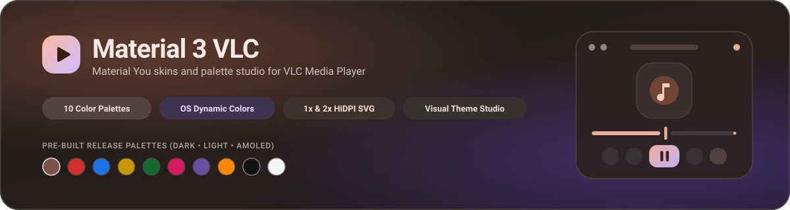
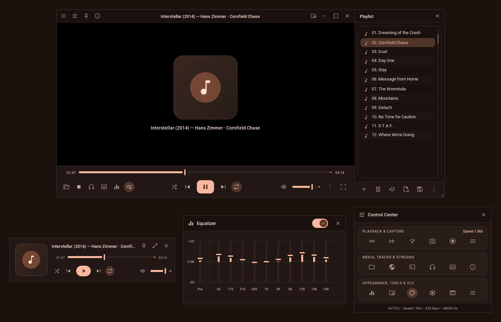
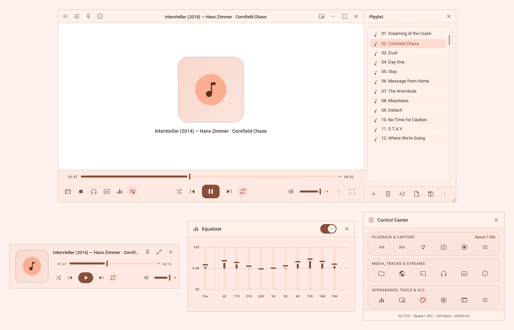
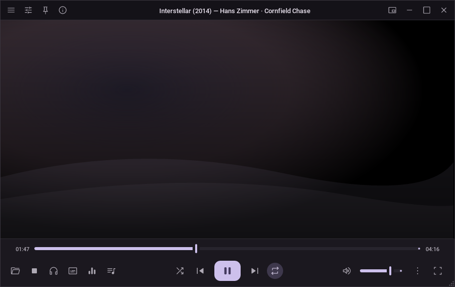
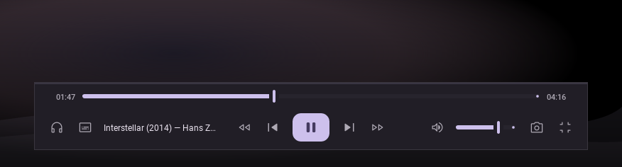
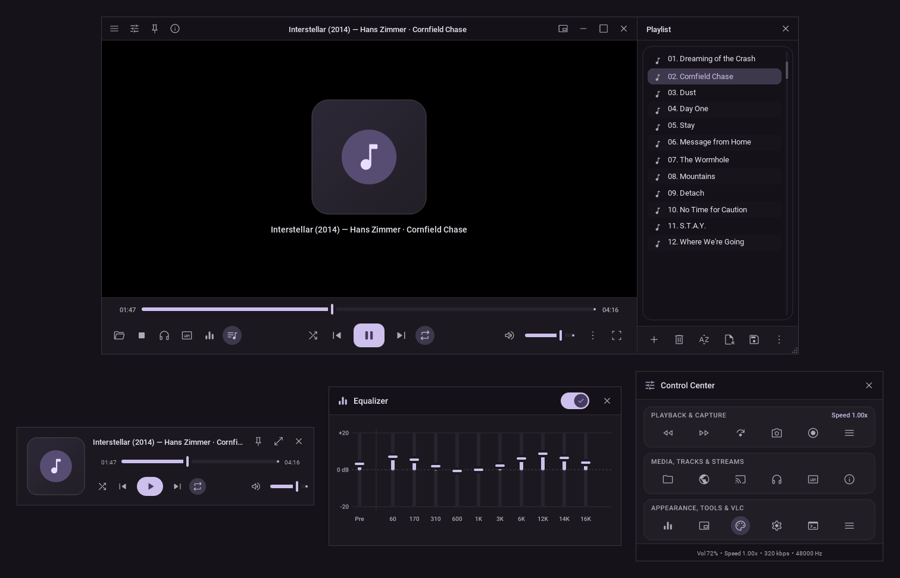
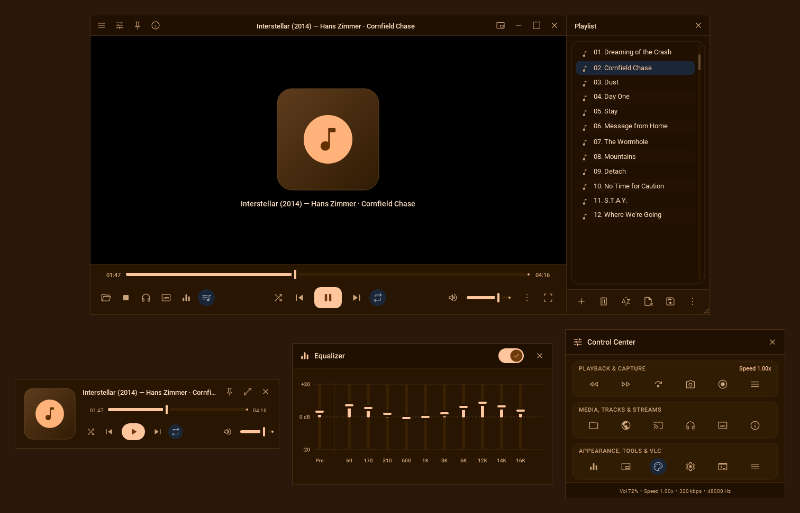
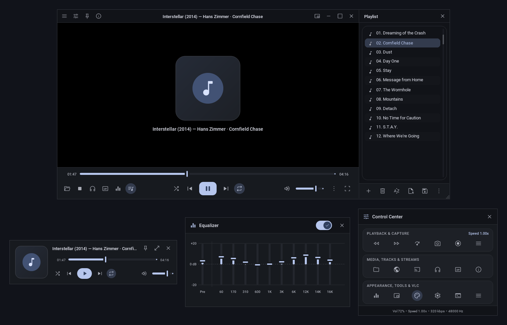
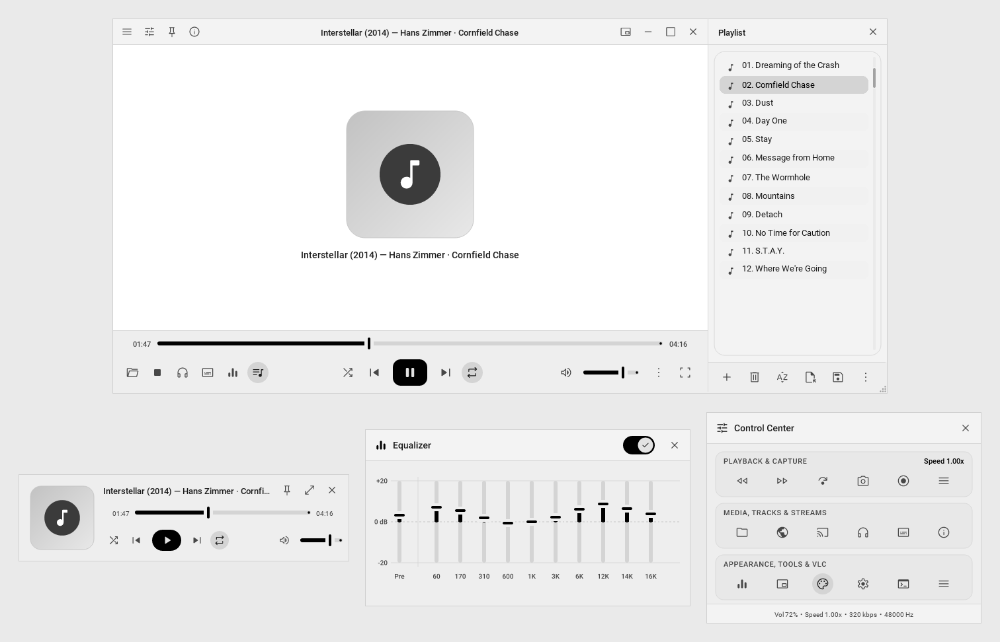
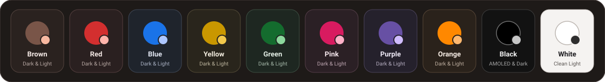

<div align="center">



<br/><br/>

[](https://github.com/PedroBrantes/material3-vlc/releases)
[](https://www.videolan.org/vlc/skins.php)
[](LICENSE)

[](https://ko-fi.com/brantes)
[](https://patreon.com/brantes)
[](https://github.com/sponsors/PedroBrantes)

<p>
  Material 3 skins for VLC Media Player, generated from HCT color tokens.<br/>
  Includes 10 pre-built color palettes (Dark, Light, AMOLED), 1x &amp; 2x HiDPI builds, OS wallpaper color sync, and a local palette editor.
</p>

<p>
  <a href="#screenshots">Screenshots</a> ·
  <a href="#palettes">Palettes</a> ·
  <a href="#install">Install</a> ·
  <a href="#theme-studio">Theme Studio</a> ·
  <a href="#dynamic-colors">Dynamic Colors</a> ·
  <a href="#support">Support</a>
</p>

</div>

---

## Screenshots

### Brown Dark (`m3-brown-dark`)
<p align="center">
  
</p>

### Brown Light (`m3-brown-light`)
<p align="center">
  
</p>

### Video Playback & Fullscreen HUD
<p align="center">
  
</p>
<p align="center">
  
</p>

### Other Palettes
| Purple Dark (`m3-purple-dark`) | Orange Dark (`m3-orange-dark`) |
| :---: | :---: |
|  |  |

| Blue Dark (`m3-blue-dark`) | White Light (`m3-white-light`) |
| :---: | :---: |
|  |  |

---

## Palettes

Pre-built `.vlt` files for all 10 color families (in `1x` and `2x` HiDPI) are attached to every [GitHub Release](https://github.com/PedroBrantes/material3-vlc/releases).

<p align="center">
  
</p>

| Color | Dark / AMOLED | Light | Seed |
| :--- | :--- | :--- | :---: |
| **Brown** | `m3-brown-dark.vlt` | `m3-brown-light.vlt` | `#795548` |
| **Red** | `m3-red-dark.vlt` | `m3-red-light.vlt` | `#D32F2F` |
| **Blue** | `m3-blue-dark.vlt` | `m3-blue-light.vlt` | `#1A73E8` |
| **Yellow** | `m3-yellow-dark.vlt` | `m3-yellow-light.vlt` | `#C99700` |
| **Green** | `m3-green-dark.vlt` | `m3-green-light.vlt` | `#146C2E` |
| **Pink** | `m3-pink-dark.vlt` | `m3-pink-light.vlt` | `#D81B60` |
| **Purple** | `m3-purple-dark.vlt` | `m3-purple-light.vlt` | `#6750A4` |
| **Orange** | `m3-orange-dark.vlt` | `m3-orange-light.vlt` | `#FF8800` |
| **Black** | `m3-black-amoled.vlt` / `m3-black-dark.vlt` | — | `#808080` |
| **White** | — | `m3-white-light.vlt` | `#808080` |

---

## Features

- **Layouts:** Main player, docked playlist side sheet, compact mini-player, 10-band equalizer, control center, floating fullscreen HUD, and about dialog.
- **Controls:** Morphing Play/Pause FAB, seek and volume sliders with M3 handle gap, 3-state repeat toggle, DVD bar, audio/subtitle menus, and theme-matched window controls.
- **HiDPI:** Vector-rendered at `1x`, `1.25x`, `1.5x`, or `2x` with surface-matched sprites (no jagged Win32 1-bit edges).
- **Color Engine:** HCT color roles (`materialyoucolor`), Dark / Light / AMOLED modes, contrast presets, and automated WCAG AA/AAA + VLC `skin.dtd` checks.

---

## Install

> VLC `skins2` works on **Windows** and **Linux** (not supported on macOS).

### Manual (no Python needed)
1. Download the `.vlt` file(s) from [Releases](https://github.com/PedroBrantes/material3-vlc/releases).
2. Copy them to VLC's skins folder:
   - **Windows:** `%APPDATA%\vlc\skins\` (`Win + R` → `%APPDATA%\vlc\skins`)
     *Use `skins` (not `skins2`) on Windows so every theme appears under Interface → Select Skin.*
   - **Linux:** `~/.local/share/vlc/skins2/` (Debian/Ubuntu: `sudo apt install vlc-plugin-skins2`; Arch: `sudo pacman -S vlc-gui-skins2`)
3. In VLC, open **Tools → Preferences** (`Ctrl + P`) → **Interface → Look and feel** → **Use custom skin**.
4. Pick your `.vlt` file under **Skin resource file**, click **Save**, and restart VLC.

Once active, right-click VLC → **Interface → Select Skin** (or use the palette button in the Control Center) to switch themes.

### CLI
Requires Python 3.11+ and [`uv`](https://docs.astral.sh/uv/):

```bash
git clone https://github.com/PedroBrantes/material3-vlc.git
cd material3-vlc
uv sync

# Build and install all 19 presets, activate Brown Dark, and restart VLC
uv run m3vlc install-all --activate-preset m3-brown-dark --restart

# Revert back to VLC's default Qt UI
uv run m3vlc reset-ui
```

---

## Theme Studio

Launch the local browser UI to tweak individual color roles and apply directly to VLC:

```bash
uv run m3vlc studio
```

- Quick swatches for all 10 color families + Dark / Light / AMOLED toggle
- Individual color pickers for 17 Material 3 roles with live contrast ratios
- One-click OS wallpaper sync and **Save, Apply & Restart VLC**

---

## Dynamic Colors

Generate a skin from your current desktop wallpaper, system accent, or any hex seed:

```bash
# Sync from active Windows/Linux wallpaper and OS theme
uv run m3vlc sync --activate --restart

# Sync from OS accent color
uv run m3vlc sync --source accent --mode dark --restart

# Watch for wallpaper/theme changes
uv run m3vlc sync --watch --interval 5

# Custom seed or image with optional per-role overrides
uv run m3vlc build --seed "#795548" --mode dark --override primary=#FFB74D --restart
uv run m3vlc build --wallpaper ~/Pictures/wallpaper.jpg --mode dark --restart
```

---

## Support

This project is MIT licensed. If you'd like to support development:

<div align="center">

[](https://ko-fi.com/brantes)
[](https://patreon.com/brantes)
[](https://github.com/sponsors/PedroBrantes)
[](https://github.com/PedroBrantes/material3-vlc/issues)

</div>

---

## Docs & Contributing

See [CONTRIBUTING.md](CONTRIBUTING.md) for dev setup and PR guidelines.

- [Architecture](docs/ARCHITECTURE.md)
- [Design System Mapping](docs/DESIGN_SYSTEM.md)
- [VLC Skins2 Notes](docs/SKINS2_NOTES.md)
- [Roadmap](docs/ROADMAP.md)

## License & Credits

- Code & skins: [MIT](LICENSE)
- Icons: [Material Symbols Rounded](https://fonts.google.com/icons) (Apache-2.0)
- Font: [Roboto](https://github.com/googlefonts/roboto-2) (Apache-2.0)
- Third-party notices: [THIRD_PARTY_NOTICES.md](THIRD_PARTY_NOTICES.md)
- Inspired by [`PapirusDevelopmentTeam/materia-vlc`](https://github.com/PapirusDevelopmentTeam/materia-vlc)
